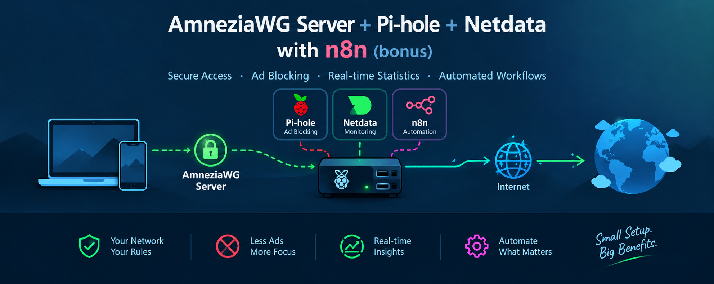
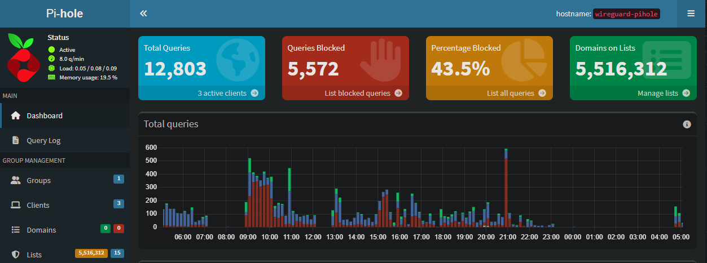
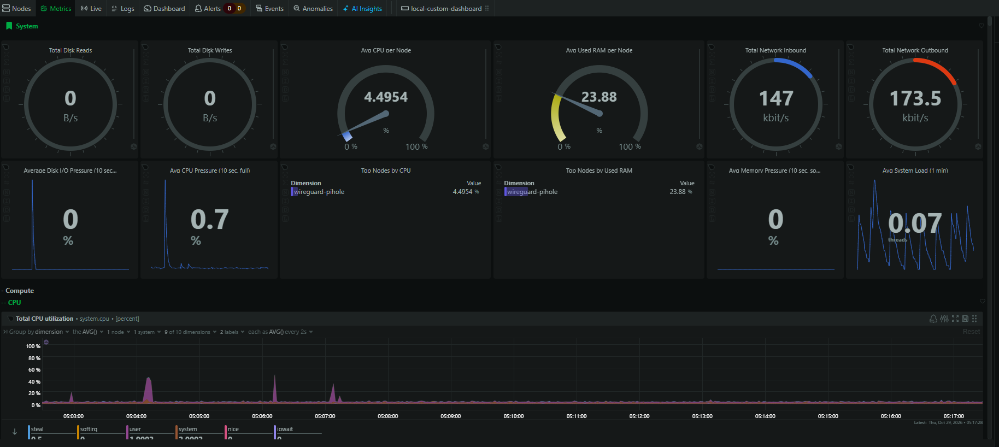
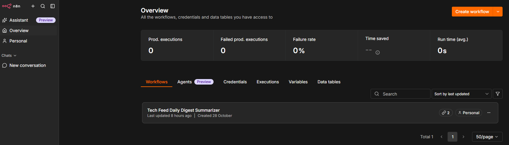
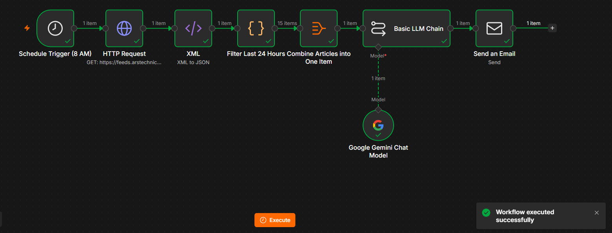

<p align="left">
  
</p>

# AmneziaWG VPN with Pi-hole and Netdata for statistics (and n8n as a bonus)

A clean, self-hosted setup combining **AmneziaWG**, **Pi-hole** and **Netdata** , designed for **Ubuntu 24.04 ARM64** and hardened so web dashboards stay bound to only the private VPN interface.

### What’s Inside
- **AmneziaWG:** WireGuard compatibility with traffic obfuscation to bypass deep packet inspection.
- **Pi-hole:** Network-wide DNS filtering across all connected VPN clients.
- **Netdata:** Live CPU, memory, bandwidth, and system health telemetry at a glance.
- **Private-by-Default Exposure:** Admin UIs stay reachable over the VPN tunnel rather than exposed on public ports.
- **n8n (bonus):** A visual, node-based workflow automation platform that connects different apps, APIs, and AI agents so they can exchange data and run tasks automatically.


**AmneziaWG**: WireGuard with traffic obfuscation, so it keeps working on networks that detect and block plain WireGuard. It is installed with the open-source [AmneziaWG Server Tools](https://wiresock.net/wiresock-awg-server-tools) by WireSock. **Pi-hole** blocks ads and trackers for every connected client and **Netdata** shows live server statistics. On the client side you use [WireSock Secure Connect](https://wiresock.net/wiresock-secure-connect/download) on Windows and the official AmneziaWG apps on Linux, macOS, iOS and Android.

This runs completely free of charge on an Ubuntu 24.04 instance on Oracle Cloud Free Tier (shape `VM.Standard.A1.Flex`: 1 OCPU, 6 GB memory, 10 TB p/m free outbound internet traffic). But you can use any other.


## Index

- [Why AmneziaWG instead of WireGuard?](#why-amneziawg-instead-of-wireguard)
  - [How AmneziaWG differs from WireGuard](#how-amneziawg-differs-from-wireguard)
  - [Trade-offs and when plain WireGuard is enough](#trade-offs-and-when-plain-wireguard-is-enough)
- [Create the Oracle Cloud instance](#create-the-oracle-cloud-instance)
- [Update Ubuntu first](#update-ubuntu-first)
- [Step 1: Open the VPN port in the firewall](#step-1-open-the-vpn-port-in-the-firewall)
- [Step 2: Install Pi-hole](#step-2-install-pi-hole)
  - [Make the Pi-hole admin page and DNS reachable for VPN clients](#make-the-pi-hole-admin-page-and-dns-reachable-for-vpn-clients)
  - [Pi-hole extra blocklists](#pi-hole-extra-blocklists)
- [Step 3: Install the AmneziaWG server](#step-3-install-the-amneziawg-server)
  - [Run the installer](#run-the-installer)
  - [Manage clients](#manage-clients)
  - [Optional: web panel for managing clients](#optional-web-panel-for-managing-clients)
  - [Optional: obfuscation proxy (QUIC, DNS, STUN or SIP)](#optional-obfuscation-proxy-quic-dns-stun-or-sip)
- [Step 4: Install and configure VPN clients](#step-4-install-and-configure-vpn-clients)
  - [Which client for which platform](#which-client-for-which-platform)
  - [Get a client profile from the server](#get-a-client-profile-from-the-server)
  - [Windows: WireSock Secure Connect](#windows-wiresock-secure-connect)
  - [Linux](#linux)
  - [macOS](#macos)
  - [iOS](#ios)
  - [Android](#android)
  - [Check that everything works](#check-that-everything-works)
- [Step 5: Install Netdata (real-time server performance monitoring)](#step-5-install-netdata-real-time-server-performance-monitoring)
- [Step 6: Install n8n (workflow automation)](#step-6-install-n8n-workflow-automation)
- [Troubleshooting](#troubleshooting)
- [The results](#the-results)
- [Credits and links](#credits-and-links)

---

## Why AmneziaWG instead of WireGuard?

WireGuard is fast, small and widely reviewed, but it has one weakness: its packets are easy to recognize. The handshake messages have fixed sizes (148, 92 and 64 bytes) and fixed header values, so Deep Packet Inspection (DPI) at a hotel, school, employer, mobile carrier or national firewall can identify a WireGuard tunnel and block or throttle it, without being able to read the traffic.

[AmneziaWG](https://docs.amnezia.org/documentation/amnezia-wg) is a fork of WireGuard-Go that keeps the WireGuard cryptography and removes that fingerprint.

### How AmneziaWG differs from WireGuard

| | WireGuard | AmneziaWG |
| --- | --- | --- |
| Cryptography | Noise_IK, Curve25519, ChaCha20-Poly1305 | Identical, unchanged |
| Packet fingerprint | Fixed header values and message sizes, easy for DPI to match | Random padding, header value ranges and junk packets, no stable signature |
| Imitating other protocols | No | Yes: QUIC, DNS, SIP, STUN |
| Transport | UDP | UDP |
| Linux server | Kernel module | Kernel module (same cipher, same speed class) |
| Compatibility | Official WireGuard apps | Needs an AmneziaWG-capable client (see [Step 4](#step-4-install-and-configure-vpn-clients)). With all obfuscation parameters disabled it is compatible with plain WireGuard |

What AmneziaWG adds on top of WireGuard:

- **Random padding (`S1`-`S4`)** on handshake and data packets, so packet sizes no longer match WireGuard's.
- **Custom header values from ranges (`H1`-`H4`)**, different for every installation, so there is no universal DPI rule to write.
- **Junk packets (`Jc`, `Jmin`, `Jmax`)** that blur the start of every session.
- **Signature packets** that imitate a real protocol such as QUIC before the handshake.
- **AWG 2.0** (the default in this guide) keeps changing headers and packet sizes while data is flowing, not only at the start of the connection.

On top of that, the AmneziaWG Server Tools used in this guide offer an optional proxy that makes the server's UDP port look and answer like a QUIC, DNS, STUN or SIP service, and WireSock Secure Connect (Windows) can disguise the client's own packets in the same way.

### Trade-offs and when plain WireGuard is enough

- **No extra cryptographic security.** AmneziaWG makes your VPN harder to detect and block, it does not encrypt "better" than WireGuard.
- **Compatible clients are required.** The stock WireGuard apps cannot use obfuscated profiles. Step 4 covers a client for every platform.
- **Kernel module maintenance.** On the server AmneziaWG runs as a DKMS kernel module, which is rebuilt after kernel updates (see [Troubleshooting](#troubleshooting)).
- **Community tooling.** AmneziaWG Server Tools is an independent project, not affiliated with Amnezia.
- **Obfuscation is a cat-and-mouse game.** AmneziaWG has moved through versions 1.5, 2.0 and 3.1. This guide uses AWG 2.0, the installer default.

If plain WireGuard works on every network you use, it is the simpler choice. If you travel, use mobile networks or work behind filtering firewalls, AmneziaWG gives you the same Pi-hole, Netdata and n8n setup with a much better chance of staying connected.

---

## Create the Oracle Cloud instance

Apart from the defaults while creating an instance, choose the correct image (Ubuntu 24.04), shape (`VM.Standard.A1.Flex`), manually assign a private IPv4 address (e.g. `10.0.0.10`, depending on your chosen subnet) and enable public IPv4 address assignment. Don't forget to download your private SSH key, because it's your only chance to do so!!!

When your instance is running, you can connect to it with PuTTY (`ubuntu@public_ip`). Convert your private key with PuTTYgen to a `.ppk` format and use this file to connect to your instance.

> [!NOTE]
> Oracle Cloud officially updated the limits for the Always Free Ampere A1 allocation. Current limit: 2 OCPUs and 12 GB RAM (1,500 OCPU hours and 9,000 GB hours per month).

> [!TIP]
> Choose a private subnet that does not overlap with your home or office LAN (for example `10.20.0.0/24` instead of `10.0.0.0/24`). Otherwise VPN clients cannot reach the instance's private address, which is used for n8n in step 6.

## Update Ubuntu first

```bash
sudo apt update && sudo apt upgrade -y
sudo reboot
```

> [!IMPORTANT]
> Do reboot. The AmneziaWG kernel module is built for the kernel that is running, so the server must be on its latest kernel before you install it. Reconnect after a minute.

## Step 1: Open the VPN port in the firewall

Pick a UDP port for the VPN. This guide uses `51820`, but any free UDP port works. You need it in the next steps.

> [!NOTE]
> Open this port in the Oracle Cloud security list too (VCN > Security List > Add Ingress Rule: source `0.0.0.0/0`, protocol `UDP`, destination port `51820`).

```bash
sudo iptables -I INPUT -p udp --dport 51820 -j ACCEPT
sudo netfilter-persistent save   # make your iptables rules persistent across reboots
```

> [!NOTE]
> All firewall rules in this guide use `-I INPUT`, which inserts the rule at the top of the chain, so it always ends up above the REJECT rule of the Oracle Ubuntu image. Check the result at any time with: `sudo iptables -L INPUT -v -n --line-numbers`

## Step 2: Install Pi-hole

*Install Pi-hole before the VPN, so DNS works from the very first connection.*

```bash
curl -sSL https://install.pi-hole.net | bash
```

Follow the steps in the wizard. Choose the server's normal network interface (for example `enp0s6`); the VPN interface does not exist yet. Set or change the admin password afterwards with:

```bash
sudo pihole setpassword
```

### Make the Pi-hole admin page and DNS reachable for VPN clients

```bash
sudo iptables -I INPUT -i awg0 -p udp --dport 53 -j ACCEPT
sudo iptables -I INPUT -i awg0 -p tcp --dport 53 -j ACCEPT
sudo iptables -I INPUT -i awg0 -p tcp --dport 80 -j ACCEPT
sudo iptables -I INPUT -i awg0 -p tcp --dport 443 -j ACCEPT
sudo netfilter-persistent save   # make your iptables rules persistent across reboots
```

> [!NOTE]
> `awg0` is the name of the VPN interface that the AmneziaWG installer creates in step 3 (the default). The rules can be added before the interface exists. The two rules for port 53 are what lets VPN clients actually use Pi-hole for DNS.

> [!TIP]
> Leave Pi-hole's interface setting on the default **Allow only local requests**. The VPN subnet is a local subnet for the server, so VPN clients are accepted, and port 53 is not opened in the Oracle security list or in iptables for any other interface, so Pi-hole cannot become an open resolver. The stricter "Respond only on interface" modes are not needed here and can break DNS at boot if Pi-hole starts before `awg0` exists.

### Pi-hole extra blocklists

When Step 3 is completed and you're connected through VPN, the Pi-hole admin page becomes available outside your Putty terminal (http://<private-ip-address-instance> Login and add the extra blocklists under **Lists** (Adlists), then run **Tools > Update Gravity** (or `pihole -g` on the server).

From [blog.burstbytes.com.au](https://blog.burstbytes.com.au/best-2026-pi-hole-blocklists-and-how-to-install-them/#How_to_install_a_Pi-hole_blocklist):

- https://raw.githubusercontent.com/hagezi/dns-blocklists/main/adblock/multi.txt
- https://raw.githubusercontent.com/hagezi/dns-blocklists/main/adblock/popupads.txt
- https://raw.githubusercontent.com/hagezi/dns-blocklists/main/adblock/tif.txt
- https://raw.githubusercontent.com/hagezi/dns-blocklists/main/adblock/fake.txt

From [zachlagden/Pi-hole-Optimized-Blocklists](https://github.com/zachlagden/Pi-hole-Optimized-Blocklists):

- https://media.githubusercontent.com/media/zachlagden/Pi-hole-Optimized-Blocklists/main/lists/all_domains.txt

Other generic lists:

- https://raw.githubusercontent.com/StevenBlack/hosts/master/hosts
- https://nsfw.oisd.nl
- https://big.oisd.nl

> [!NOTE]
> A few things to keep in mind:
> - `nsfw.oisd.nl` blocks adult content for every VPN client. Remove it if you don't want that.
> - If a site breaks, check the Pi-hole Query Log and allow the domain from there.

## Step 3: Install the AmneziaWG server

The [AmneziaWG Server Tools](https://wiresock.net/wiresock-awg-server-tools) (MIT license) install and manage an AmneziaWG server on Debian 11+ or Ubuntu 22.04+ (tested on 22.04, 24.04 and 26.04). One script installs the VPN, configures the server and writes the client configs. New installs use AWG 2.0.

### Run the installer

```bash
curl -fLO https://raw.githubusercontent.com/wiresock/awg-server-tools/main/amneziawg-install.sh
chmod +x amneziawg-install.sh
sudo ./amneziawg-install.sh
```

Answer the prompts like this (the wording can differ slightly):

| Prompt | Answer |
| --- | --- |
| Public IP address or hostname | The **public** IP of your instance. |
| Public network interface | The default |
| AmneziaWG interface name | `awg0` (default). The firewall rules from step 2 use this name |
| Server IPv4 address | `10.66.66.1` (default). This is also the address of Pi-hole for VPN clients |
| IPv6 | The default |
| Server UDP port | `51820`, the port you opened in step 1 |
| DNS resolvers for the clients | `10.66.66.1` (Pi-hole) for both. A second public resolver would let clients bypass Pi-hole |
| Allowed IPs | The default `0.0.0.0/0,::/0` (all traffic through the VPN) |
| First client name | For example `laptop` |

> [!NOTE]
> Accept all other defaults regarding specific connection parameters (like Jc, Jmin, Jmax, MTU, S1 etc.)

Prefer a non-interactive install? The same answers as environment variables:

```bash
sudo AUTO_INSTALL=y SERVER_PUB_IP=<your-public-ip> SERVER_PORT=51820 \
  CLIENT_DNS_1=10.66.66.1 CLIENT_DNS_2=10.66.66.1 ./amneziawg-install.sh
```

Now removing the blocking iptables FORWARD rule:
```bash
sudo iptables -D FORWARD 1
```

Check that the server is running:

```bash
sudo awg show
```

> [!NOTE]
> Keep AWG 2.0, the default for new installs. AWG 3.1 can be enabled later, but only do that when every client app supports it, and not when you use the obfuscation proxy below (the proxy works with AWG 1.0 and 2.0 only).

### Manage clients

> [!NOTE]
> Create one client per device, never share a profile between devices.

Running `sudo ./amneziawg-install.sh` without arguments opens the interactive menu to add or remove clients, list all clients or revoke existing clients.


### Optional: web panel for managing clients

The web panel manages clients, shows traffic and expiration dates and exports configs and QR codes. It is built from source, so the server needs `git` and about 2 GiB of free space.

```bash
curl -fLO https://raw.githubusercontent.com/wiresock/awg-server-tools/main/amneziawg-web.sh
chmod +x amneziawg-web.sh
sudo ./amneziawg-web.sh install --install-rust
```

The panel only listens on `127.0.0.1:8080` of the server. Open an SSH tunnel from your computer and browse to `http://localhost:8080`:

```bash
ssh -i /path/to/your-oracle-key -L 8080:127.0.0.1:8080 ubuntu@<your-public-ip>
```

With PuTTY: **Connection > SSH > Tunnels**, source port `8080`, destination `127.0.0.1:8080`, click **Add**, then open the session.

### Optional: obfuscation proxy (QUIC, DNS, STUN or SIP)

For networks that are very strict, `amneziawg-proxy` sits in front of AmneziaWG and answers probes like a real QUIC, DNS, STUN or SIP service. On its own it disguises the server-to-client direction. With WireSock Secure Connect 3.6 or later on Windows the client disguises its own packets too, so both directions look like the imitated protocol.

| Mode | What DPI sees | Typical port | Good for |
| --- | --- | --- | --- |
| `quic` | QUIC 1-RTT and Version Negotiation | 443 | Networks heavy on QUIC and HTTP/3 (safest default) |
| `dns` | DNS queries and responses | 53 | DNS-filtered networks |
| `stun` | STUN Binding traffic | 3478 | Networks that allow WebRTC and NAT traversal |
| `sip` | SIP signaling | 5060 | Networks that allow VoIP |

```bash
curl -fLO https://raw.githubusercontent.com/wiresock/awg-server-tools/main/amneziawg-proxy.sh
chmod +x amneziawg-proxy.sh
sudo ./amneziawg-proxy.sh
```

Without arguments the script walks you through the settings, and running it again opens a management menu. A non-interactive example (QUIC imitation on UDP 443):

```bash
sudo ./amneziawg-proxy.sh --non-interactive --listen-port 443 --protocol quic
```

> [!IMPORTANT]
> - Open the proxy's listen port as **UDP** in the Oracle security list and in iptables (`sudo iptables -I INPUT -p udp --dport 443 -j ACCEPT`, then `sudo netfilter-persistent save`).
> - If the proxy listens on a different port than the VPN used before (for example 443 instead of 51820), change the port in the `Endpoint =` line of every client profile.
> - Don't use `dns` mode on this server: Pi-hole already uses port 53. `quic` on UDP 443 does not conflict with Pi-hole's TCP port 443.

---

## Step 4: Install and configure VPN clients

> [!IMPORTANT]
> **WireSock Secure Connect is available for Windows only.** There are no WireSock versions for macOS, Linux, Android or iOS. On those platforms you use the official AmneziaWG apps, which import the very same `.conf` profile from your server.

### Which client for which platform

| Platform | Client | Notes |
| --- | --- | --- |
| Windows 10/11 | [WireSock Secure Connect](https://wiresock.net/wiresock-secure-connect/download) | Free for personal use. Per-app split tunneling and protocol masking. Supports AmneziaWG 2.0 profiles |
| Linux | `awg-quick` from the [Amnezia PPA](https://docs.amnezia.org/documentation/instructions/install-amneziawg-kernel-module-linux) | Command line, Ubuntu and Debian |
| macOS 12+ | [AmneziaWG](https://apps.apple.com/app/amneziawg/id6478942365) (App Store) | |
| iOS 15+ | [AmneziaWG](https://apps.apple.com/app/amneziawg/id6478942365) (App Store) | |
| Android 7+ | [AmneziaWG](https://play.google.com/store/apps/details?id=org.amnezia.awg) (Google Play) | WG Tunnel (F-Droid or GitHub) is a third-party alternative |

> [!NOTE]
> The stock WireGuard apps cannot use these profiles, because they do not know the AmneziaWG parameters (`Jc`, `S1`, `H1`, ...). Use one of the clients above.

### Get a client profile from the server

The installer saves each profile as `awg0-client-<name>.conf`. Find it with:

```bash
sudo find / -name 'awg0-client-*.conf' 2>/dev/null
```

**Option 1: copy and paste** (works well for the laptop):

```bash
sudo cat /path/shown/above/awg0-client-laptop.conf
```

1. Highlight and copy the entire output text from the terminal (starting from `[Interface]` down to the last line).
2. On your laptop, open Notepad (or any text editor) and paste the text.
3. Save the file as `home-vpn.conf` (choose **Save as type: All files**, so it doesn't become `home-vpn.conf.txt`).

**Option 2: scp** (Linux and macOS; on Windows use `pscp` from PuTTY):

```bash
sudo cp /path/shown/above/awg0-client-laptop.conf ~/ && sudo chown $USER: ~/awg0-client-laptop.conf
scp -i /path/to/your-oracle-key ubuntu@<your-public-ip>:awg0-client-laptop.conf .
```

**Option 3: QR code** (for phones and tablets):

```bash
sudo apt install -y qrencode
sudo cat /path/shown/above/awg0-client-iphone.conf | qrencode -t ansiutf8
```

The web panel can also export configs and QR codes, see [step 3](#optional-web-panel-for-managing-clients).

> [!WARNING]
> A profile contains the client's private key. Don't send it by email or chat, and delete the copies you don't need anymore (also the copy in the server's home directory).

### Windows: WireSock Secure Connect

WireSock Secure Connect works on Windows 10 and 11 (x86, x64, ARM64) and needs the .NET Desktop Runtime 10. The installer downloads it automatically when it is missing, so an internet connection is required during setup.

1. Download the installer from [wiresock.net](https://wiresock.net/wiresock-secure-connect/download) and run it.
2. Accept the terms of use. The installer installs .NET (if needed), the WireSock kernel modules and then the app. Click **Close** to finish.
3. Start WireSock Secure Connect. On the first start it asks you to import a profile: click **Browse** and select your `.conf` file, or drag and drop it onto the window. You can import several profiles at once.
4. Select the profile in the combo box and click the connection toggle. The app shows the connection statistics and the external IP of the VPN server.
5. To disconnect, click the toggle again. You can also close the app and choose to keep the VPN connection active.

Useful profile settings (**Preferences > Profiles > Edit**, or edit the profile in text mode):

- **Tunneled networks/addresses**: the default `0.0.0.0/0, ::/0` sends everything through the VPN. Add `192.168.1.0/24` (your own LAN) to **Non-tunneled networks/addresses** to keep local devices reachable.
- **Tunneled applications**: send only selected apps (for example `firefox`) through the VPN (split tunneling). This is combined with the networks list using AND.
- **MTU**: lower it (for example `1280`) if sites load slowly or not at all on mobile or PPPoE connections.

#### Optional: protocol masking with the obfuscation proxy

Use this together with the [obfuscation proxy](#optional-obfuscation-proxy-quic-dns-stun-or-sip) (WireSock Secure Connect 3.6 or later; SIP and STUN masking need 3.6.1.1 or later). Edit the profile in text mode (**Preferences > Profiles > Edit**), set `Jc = 0` for QUIC and add the masking lines. Alternatively use the **DPI protection** tab in the wizard.

```ini
[Interface]
# ... keep PrivateKey, Address, DNS and the other generated lines ...
# Junk packets off, required with QUIC masking
Jc = 0
# Protocol masking: same protocol as the proxy on the server
# Id = a popular domain in your region, Ip = QUIC / DNS / SIP / STUN, Ib = Chrome / Firefox / cURL
Id = example.com
Ip = QUIC
Ib = Chrome
```

If you run the proxy with `--protocol auto`, it follows what each client uses.

### Linux

Install the AmneziaWG kernel module and tools from the Amnezia PPA (Ubuntu). For Debian follow the [Amnezia guide](https://docs.amnezia.org/documentation/instructions/install-amneziawg-kernel-module-linux); for other distributions see [AmneziaWG-Go](https://docs.amnezia.org/documentation/instructions/install-amneziawg-go).

```bash
sudo apt update && sudo apt install -y software-properties-common python3-launchpadlib gnupg2 linux-headers-$(uname -r)
sudo add-apt-repository ppa:amnezia/ppa
sudo apt install -y amneziawg
modinfo amneziawg   # should print module information
```

Install the profile (choose a short name, it becomes the interface name) and connect:

```bash
sudo install -m 600 ~/home-vpn.conf /etc/amnezia/amneziawg/awg-home.conf
sudo awg-quick up awg-home
sudo awg show                       # a "latest handshake" line means it works
```

Disconnect with `sudo awg-quick down awg-home`. To start the VPN at boot:

```bash
sudo systemctl enable --now awg-quick@awg-home
```

> [!NOTE]
> If `awg-quick` complains that `resolvconf` is missing, install `resolvconf` (or `openresolv`). It is needed to apply the `DNS =` line of the profile.

### macOS

1. Install **AmneziaWG** from the [App Store](https://apps.apple.com/app/amneziawg/id6478942365) (macOS 12.0 or later).
2. Get the `.conf` profile onto your Mac (AirDrop or `scp`, see [above](#get-a-client-profile-from-the-server)).
3. Open AmneziaWG and click **Import tunnel(s) from file**, then select the `.conf` file.
4. If macOS asks for permission to add VPN configurations, click **Allow**.
5. Select the tunnel and click **Activate**.

### iOS

1. Install **AmneziaWG** from the [App Store](https://apps.apple.com/app/amneziawg/id6478942365) (iOS 15.0 or later).
2. Open the app and tap **Add a tunnel**.
3. **QR code:** choose **Create from QR code** and scan the QR code you made with `qrencode` (or exported from the web panel). Give the tunnel a name and allow the VPN configuration.
   **File:** choose **Create from file or archive**, or press and hold the `.conf` file in the Files app, tap **Share** and select **AmneziaWG**.
4. Tap the switch next to the tunnel name. It turns green when connected.

### Android

1. Install **AmneziaWG** from [Google Play](https://play.google.com/store/apps/details?id=org.amnezia.awg) (Android 7.0 or later).
2. Tap the plus icon in the bottom-right corner and choose **Scan from QR code**, or **Import from file or archive** for the `.conf` file.
3. Tap the switch next to the tunnel name. **Connected** appears under the name.

> [!TIP]
> If ads still show up, check **Private DNS** in your Android network settings. A private DNS provider overrides the VPN's DNS (and so Pi-hole). Set it to **Off** or **Automatic**.

### Check that everything works

Connect with any client and check:

1. The client shows a recent handshake and traffic counters.
2. Pi-hole opens at `http://10.66.66.1/admin` and your device shows up in the Query Log.
3. Your public IP is the one of your Oracle instance (for example with the [WireSock IP check](https://wiresock.net/tools/check-ip)).
4. Netdata opens at `http://10.66.66.1:19999` and n8n at `http://10.0.0.10:5678` (the private IP you bind it to in step 6), once those steps are done.

## Step 5: Install Netdata (real-time server performance monitoring)

*Netdata provides an incredible, low-overhead real-time monitoring dashboard that will give you instant visibility into your network traffic.*

```bash
sudo wget -O /tmp/netdata-kickstart.sh https://get.netdata.cloud/kickstart.sh && sh /tmp/netdata-kickstart.sh
sudo iptables -I INPUT -i awg0 -p tcp --dport 19999 -j ACCEPT
sudo netfilter-persistent save   # make your iptables rules persistent across reboots
```

## Step 6: Install n8n (workflow automation)

*n8n is a visual, node-based workflow automation platform that connects different apps, APIs, and AI agents so they can exchange data and run tasks automatically.*

```bash
mkdir -p ~/n8n
cd ~/n8n
nano docker-compose.yml
```

Paste the code and save.

```yaml
services:
  n8n:
    image: docker.io/n8nio/n8n:latest
    container_name: n8n
    restart: unless-stopped
    ports:
      # Binds n8n to the private IP of your instance on port 5678, so it is not served on other addresses
      - "10.0.0.10:5678:5678"  #NOTE!:replace ip address with your own private ip address!
    environment:
      - N8N_HOST=10.0.0.10  #NOTE!:replace ip address with your own private ip address!
      - N8N_PORT=5678
      - N8N_PROTOCOL=http
      - N8N_SECURE_COOKIE=false
      - NODE_ENV=production
      - GENERIC_TIMEZONE=Europe/Amsterdam  #NOTE!:change this to your own timezone!
      - TZ=Europe/Amsterdam  #NOTE!:change this to your own timezone!
    volumes:
      # Persists workflows, execution history, and credentials across container restarts
      - n8n_data:/home/node/.n8n

volumes:
  n8n_data:
```

> [!NOTE]
> Put `N8N_SECURE_COOKIE=false` in the YAML file to be able to access the site over http.

```bash
sudo apt install -y docker.io docker-compose-v2   # install Docker and Docker Compose plugin
sudo systemctl enable --now docker                # start and enable Docker service
sudo usermod -aG docker $USER                     # allow the ubuntu user to run Docker without sudo
newgrp docker                                     # apply the new group membership
docker compose up -d                              # start the service using Docker Compose
docker ps                                         # verify that n8n is running properly
sudo iptables -I INPUT -i awg0 -p tcp --dport 5678 -j ACCEPT
sudo netfilter-persistent save                    # make your iptables rules persistent across reboots
```

> [!WARNING]
> Never open ports 53, 80, 443, 5678 or 19999 in the Oracle security list. Ports published by Docker bypass the INPUT rules of the host firewall, so for n8n the security list is the only thing that keeps it off the internet.

If needed, this gracefully shuts down the container and spins it right back up with a clean restart:

```bash
docker compose down && docker compose up -d
```

## Troubleshooting

| Symptom | What to check |
| --- | --- |
| Client connects, but no internet or no DNS | The profile has `DNS = 10.66.66.1`. Pi-hole is running (`pihole status`). The port 53 rules for `awg0` exist (`sudo iptables -L INPUT -v -n --line-numbers`) |
| No handshake (`sudo awg show` shows no "latest handshake") | The UDP port is open in the Oracle security list **and** in iptables. `Endpoint` has the public IP and the right port. The profile comes from this server |
| The official WireGuard app does not work with the profile | It does not know the AmneziaWG parameters. Use WireSock Secure Connect or an AmneziaWG app (step 4) |
| Works at home, blocked on a hotel, work or mobile network | Add the [obfuscation proxy](#optional-obfuscation-proxy-quic-dns-stun-or-sip) (QUIC on UDP 443) and on Windows enable protocol masking |
| Ads still show on Android | Set **Private DNS** to **Off** or **Automatic** |
| `modinfo amneziawg` shows nothing after a kernel update | `sudo apt install linux-headers-$(uname -r)`, then `sudo dkms autoinstall` and reboot. The project README also describes an experimental userspace backend that needs no kernel module |
| Pi-hole, Netdata or n8n page does not load over the VPN | The rules for `awg0` are in place and the service runs: `pihole status`, `systemctl status netdata`, `docker ps` |

## The results

### Pi-hole

<p align="left">
  
</p>

### Netdata

<p align="left">
  
</p>

### n8n

<p align="left">
  
</p>

<p align="left">
  
</p>

## Credits and links

- [AmneziaWG Server Tools](https://wiresock.net/wiresock-awg-server-tools) by WireSock (MIT license). An independent project, not affiliated with, endorsed by or sponsored by Amnezia.
- [AmneziaWG protocol documentation](https://docs.amnezia.org/documentation/amnezia-wg) and [How to use the AmneziaWG app](https://docs.amnezia.org/documentation/instructions/use-amneziawg-app)
- [WireSock Secure Connect documentation](https://wiresock.net/documentation/wiresock-secure-connect/how-to-setup.html)
- [Pi-hole documentation](https://docs.pi-hole.net/), [Netdata](https://www.netdata.cloud/) and [n8n](https://n8n.io/)
